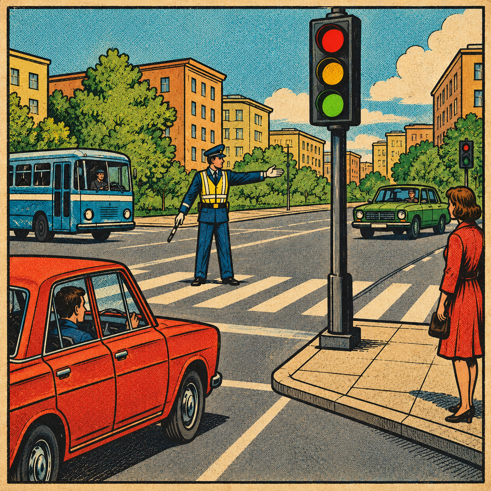

# ИДЗ №3 по курсу АКОС: Регулируемый перекрёсток

**Выполнил:** студент БПИ252 Гришин Алексей Андреевич  
**Вариант:** 39

[Полный отчёт по проекту (PDF)](./docs/report.pdf)

<div align="center">
  
</div>

## Описание проекта

Консольная многопроцессная модель регулируемого перекрёстка на C17 для Linux. Автомобили и пешеходы прибывают с разных направлений, ожидают в ограниченных очередях и пересекают общую зону по сигналам светофора.

Контроллер выбирает фазу, генераторы направлений создают прибытия, семейства участников запрашивают допуск и ожидают срок проезда. Координатор проверяет запросы, изменяет модель и ведёт журнал. При `N` направлениях работают `2N+1` рабочих и координатор, максимум 34 процесса.

## Особенности реализации

* **Четыре реализации IPC:** два варианта fork с POSIX shared memory, независимые программы с shared memory и независимые программы с FIFO.
* **Общая модель:** FIFO очередей, матрица конфликтов, ограниченная вместимость, проверка активного ID и точная цель.
* **Управление движением:** fixed/adaptive, приоритет экстренного транспорта без обгона FIFO и пешеходный запрос.
* **Реальное время:** длительность проезда и защитный интервал измеряются монотонными часами.
* **Согласованная остановка:** первая причина STOP, заморозка статистики, сбор детей и очистка собственных IPC.
* **Файловый ввод-вывод:** системные вызовы, обработка частичных операций и защита конфигурации от перезаписи журналом.

## Сборка и запуск

Нужны Linux, компилятор C17, CMake 3.20+ и Python 3.8+ для тестов и launcher. Сторонних C-библиотек нет.

```bash
./tests/run.sh none
./tests/run.sh asan

mkdir -p results
./build/crossroad_named data/demo.conf results/named.log
./build/crossroad_unnamed data/compatible.conf results/unnamed.log
python3 scripts/run_session.py --transport shm --build-dir build data/minimal.conf results/shm.log
python3 scripts/run_session.py --transport fifo --build-dir build data/minimal.conf results/fifo.log
```

`none` использует `build`, `asan` — `build-asan`. Свой компилятор можно задать через `CC`. Включены `-Wall -Wextra -Wpedantic -Wconversion -Wshadow`.

Для сборки только семи приложений Python не нужен:

```bash
cmake -S . -B build-release -DCMAKE_BUILD_TYPE=Release -DBUILD_TESTING=OFF
cmake --build build-release --parallel
./build-release/crossroad_named data/demo.conf results/demo.log
```

Интерфейс координаторов:

```text
crossroad_named|crossroad_unnamed|crossroad_shm|crossroad_fifo CONFIG [LOG] [--session DIR]
```

Без `LOG` используется `crossroad.log`. Без `--session` создаётся частный каталог `.crossroad-PID`. Указанный каталог сессии ещё не должен существовать. `--help` показывает справку.

### Ручной независимый запуск

Каждую строку выполните в отдельном терминале из корня проекта. Каталог `results` должен существовать, `results/session` — ещё не существовать.

```bash
./build/crossroad_shm data/minimal.conf results/manual.log --session results/session
./build/crossroad_controller data/minimal.conf --session results/session --transport shm
./build/crossroad_direction data/minimal.conf --session results/session --transport shm --stream A
./build/crossroad_direction data/minimal.conf --session results/session --transport shm --stream P
./build/crossroad_participants data/minimal.conf --session results/session --transport shm --stream A
./build/crossroad_participants data/minimal.conf --session results/session --transport shm --stream P
```

Для FIFO замените координатор на `crossroad_fifo`, транспорт на `fifo` и выберите новый каталог сессии. Роли можно запускать до координатора. Для каждого направления нужен один генератор и одно семейство, контроллер один. Конфигурационный файл должен оставаться неизменным: процессы сверяют контрольную сумму его байтов. Дубликат роли и неизвестное направление отклоняются.

## Конфигурация

```text
ticks 100
seed 39
strategy adaptive
min_green 2
max_green 5
clearance 1
priority 1
emergency_rate 30
tick_ms 10
delay_ms 100

stream N car north straight 4 2 500
stream S car south straight 4 2 500
stream P pedestrian east walk 2 3 100
conflict N S 0
phase cars N S
phase pedestrians P
```

Формат записей:

```text
stream NAME KIND DIRECTION MANEUVER CAPACITY CROSSING_TICKS RATE
conflict NAME_A NAME_B VALUE
phase NAME STREAM_1 STREAM_2 ...
```

`KIND`: `car` или `pedestrian`; `DIRECTION`: `north`, `east`, `south`, `west`. Манёвры автомобиля: `straight`, `right`, `left`; пешехода: `walk`. `RATE` — вероятность попытки прибытия в тысячных долях на обработанный такт, от 0 до 1000.

Вместимость очереди — 1–64 ожидающих, участник в зоне считается отдельно. Проезд — 1–1000 тактов, не больше `max_green`. Допускаются 1–16 направлений и фаз. Направления одной фазы должны быть совместимы, каждое направление должно обслуживаться.

Имена содержат 1–31 ASCII-букву, цифру, `_` или `-`. Повторные имена запрещены. Направления объявляются до ссылок на них. По умолчанию все направления конфликтуют; `conflict A B 0` симметрично разрешает совместимость, `1` запрещает. Отключать собственный конфликт нельзя.

| Параметр | По умолчанию | Допустимые значения |
|---|---:|---|
| `ticks` | 120 | 0–1000000000; 0 отключает предел |
| `target` | 0 | 0–1000000000; 0 отключает цель |
| `seed` | 39 | 0–4294967295 |
| `strategy` | adaptive | fixed / adaptive |
| `min_green`, `max_green` | 4, 10 | 1–10000, min ≤ max |
| `clearance` | 2 | 1–10000 тактов |
| `priority` | 1 | 0 / 1 |
| `emergency_rate` | 20 | 0–1000 |
| `tick_ms` | 1 | 1–60000 мс |
| `delay_ms` | 0 | 0–60000 мс |

Период `ticks × tick_ms` должен помещаться в 64-разрядное число наносекунд. Числа записываются десятичными цифрами без знаков и суффиксов. Комментарий начинается с `#`; повтор скалярного параметра заменяет его значение. Разрешены CRLF и последняя строка без перевода. Размер файла — до 16384 байт, NUL недопустим.

## Время и процессы

Отсчёт начинается после HELLO всех ролей. Время передаётся в переходы модели явно. Семейство запрашивает выход после срока проезда; координатор проверяет время ещё раз.

```text
INITIAL → GREEN → DRAIN → CLEARANCE → GREEN
```

В GREEN допускается только голова FIFO при свободном совместимом направлении. DRAIN закрывает новые въезды, сохраняя разрешение уже движущимся. CLEARANCE начинается после фактического выхода всех участников и выдерживается полностью. Поэтому начатый проезд может завершиться после окончания окна `max_green`.

Fixed циклически обходит фазы. Adaptive сравнивает возраст головы очереди, затем суммарную длину очередей, затем циклический порядок. Экстренный запрос может находиться в глубине FIFO: он влияет на фазу, сохраняя минимальное зелёное время и порядок участников. Пешеходный запрос регистрируется при постановке в очередь.

Генератор SplitMix64 адресуется по seed, направлению и номеру такта. Пропущенные такты не создают запоздалых прибытий. Асинхронные запуски могут различаться порядком событий и статистикой. `delay_ms` задаёт интервал снимков `Состояние` и не влияет на длительность проезда.

В shm передаются ячейки запрос/ответ; FIFO использует по два канала на роль. Семафоры обеспечивают публикацию и занятие ролей. Кадр — 1024 байта явно заданных 64-разрядных слов, без padding структур. Все процессы используют одну сборку и архитектуру Linux. У FIFO нет скрытой передачи модельных данных через shm.

## Завершение и журнал

Модель завершается по периоду, точной цели, `SIGINT`/`SIGTERM`, недостижимой цели при нулевых интенсивностях или ошибке. Нулевые `ticks` и `target` задают работу до сигнала или ошибки. Допуск резервирует место в цели для каждого активного участника.

После STOP очереди и статистика замораживаются. Незавершённый проезд остаётся в `в_зоне`; сбор процессов не засчитывает его как выход. Выполняется баланс:

```text
прибыло = прошло + отказов + ожидают + в_зоне
```

Координатор дублирует журнал в stdout и файл. Строки содержат номер события и относительное монотонное время. Итог включает задержки, пик очереди и число процессов. При отказе одного канала итог сохраняется в другом.

На подключение всех ролей отводится 5 секунд, на отсутствие обмена после старта — 5 секунд, на согласованную остановку — ещё 5 секунд. Родитель собирает своих детей; независимые роли ограниченно выходят при потере связи. Launcher запускает и собирает отдельные программы, не реализуя модель.

Коды: `0` — штатное завершение; `1` — ошибка; `2` — неверные аргументы или конфигурация; `3` — недостижимая цель; `128+signal` — прерывание. При контролируемом завершении удаляются только IPC своей сессии. Неперехватываемый SIGKILL координатора не гарантирует очистки.

## Проверка

```bash
ctest --test-dir build --output-on-failure
```

Проверяются модельные границы, реальные сценарии четырёх backend, ручной независимый запуск, фиксированная и адаптивная стратегии, период и цель, крайние seed, сигналы, ошибки вывода, неверный ввод, отсутствие оставшихся PID и IPC. Независимый Python-проверяющий восстанавливает очереди и активные проезды по журналу, проверяет конфликты, разрешения, сроки и итоговый баланс.

Результаты Linux-проверок (Debian 12 arm64, GCC 12.2.0):

| Сборка | CTest | Сценарии | Ручной запуск / регистрация |
|---|---|---|---|
| Debug | 2/2 | 92/92 | 2/2 и 2/2 |
| ASan/UBSan | 2/2 | 92/92 | 2/2 и 2/2 |

## Отчёт

В отчёте приведены схемы четырёх реализаций, роли и владельцы ресурсов, интерфейс, реальные журналы, результаты проверок и приложение с пользовательскими промптами.
